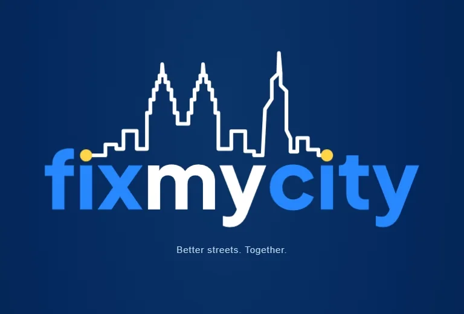
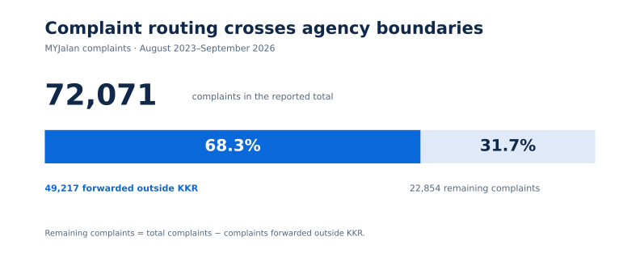
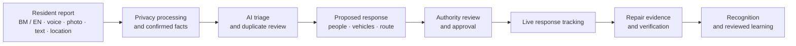
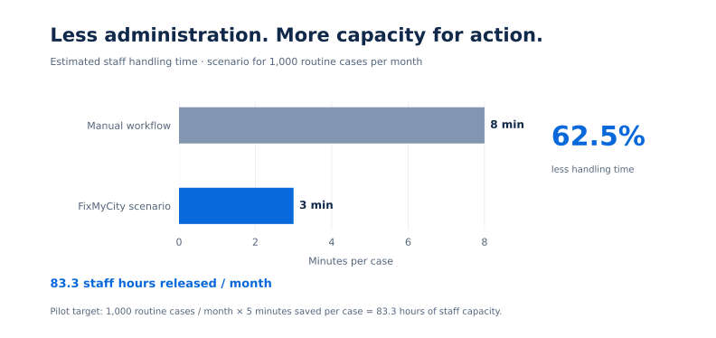
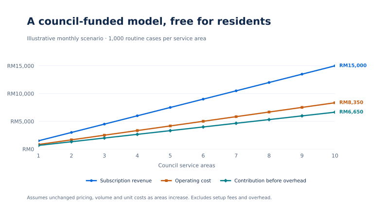

     

[Overview](#overview) · [The problem](#the-problem) · [Our solution](#our-solution) · [Key features](#key-features) · [Architecture](#architecture) · [Privacy](#security-and-privacy) · [Impact](#impact-and-measurement) · [Roadmap](#roadmap)

### [Try FixMyCity at fixmycity.online →](https://fixmycity.online)

# FixMyCity

**Better streets. Together.**

## Overview

FixMyCity is Team 404's civic incident reporting and response project for Malaysian communities. It connects residents, local councils, responders and contractors around one continuous workflow: **report an incident, approve the response, track the work and verify the repair.**

Residents can describe a situation in Bahasa Melayu or English using voice, text, photos and location. AI helps organise the evidence and prepare the next steps. Authorities review the information, approve response plans and keep responsibility for decisions. The case remains connected to repair evidence and community follow-up after immediate help arrives.

The project covers civic hazards and incidents such as road accidents, requests for medical help, theft, damaged roads, drainage problems and recurring infrastructure damage. Its proposed delivery model is an installable Progressive Web App (PWA), free for residents and supported through council adoption.

## The problem

### A rescue can finish while the hazard remains

An injured rider may receive help, but the damaged road or raised manhole that caused the incident can remain unresolved. A response to the immediate incident and a repair to its underlying cause need separate evidence, ownership and follow-up. Without that connection, the next road user can encounter the same hazard.

Two Malaysian examples highlight this gap:

- **Selangor, April 2026:** a pending raised-manhole repair was associated with an injured motorcyclist. Permanent repairs were announced the day after a video of the incident went viral.
- **Klang, September 2026:** repeated damage and theft of electrical infrastructure led to an appeal for residents and neighbourhood groups to work with the authorities.

### Residents should not have to understand every agency boundary

MYJalan received **72,071 complaints between August 2023 and September 2026**, with **49,217 complaints, or 68.3%, forwarded to agencies outside KKR**. This highlights the importance of finding the responsible asset owner and maintaining continuity when a case crosses organisational boundaries.

The wider problems are fragmented evidence, repeated reports of the same incident, unclear responsibility and limited visibility into whether a repair was completed. Counting submitted complaints alone does not show whether the original risk has been resolved.

## Our solution

**Report → approved response → verified repair.**

FixMyCity brings the resident's report, the authority's decisions, the response activity and the repair record into a connected case. AI supports the workflow, while people confirm the facts and approve consequential actions.

1. **Capture the incident.** A resident speaks, types or takes a photo and provides a location.
2. **Build and review the report.** The assistant asks relevant follow-up questions and organises the information for the resident to confirm.
3. **Triage the case.** Classification, urgency assessment and duplicate review help authorities understand what needs attention.
4. **Prepare and approve a response.** AI proposes people, vehicles and routes; the responsible authority reviews and approves the plan.
5. **Track help and repair separately.** Response progress is visible, while any underlying hazard remains open for repair follow-up.
6. **Verify the outcome.** Before-and-after evidence and confirmation support closure, recognition and future learning.

## Key features

### 1. Multimodal incident triage

Residents can report through voice, text, photos and location in **Bahasa Melayu or English**. The assistant turns an initial account into a structured report, asks questions relevant to the incident and lets the resident review the result before confirmation.

The proposed triage design combines language and visual understanding with location and time. Similar reports can be linked for duplicate review without discarding their original evidence.

### 2. AI response planning and routing

The system prepares a response plan covering the people, vehicles and route that may be required. Local protocols, verified asset ownership and resource constraints provide context for the recommendation.

**Authorities approve the plan before response actions proceed.** The purpose is to help officers prepare and assess options while retaining human responsibility for dispatch decisions.

### 3. Live response and repair tracking

Residents can follow response progress, including the assigned vehicle's location within the permitted case context. The repair task remains visible after the immediate response is complete.

Before-and-after evidence and confirmation of the fix connect the original incident to its resolution. Recurring-damage signals can then inform inspection priorities rather than treating every report as an isolated event.

### 4. Authority AI Studio

Authorities define incident-specific questions, local knowledge and response protocols. AI selects relevant questions from that reviewed material, helping residents provide the facts an officer actually needs.

This gives each council a way to adapt the assistant to its service area, language context and operating practices instead of relying on one generic reporting form.

### 5. Reviewed AI learning

An officer can correct an AI classification or case interpretation. Those corrections become reviewed examples for evaluation and future updates.

The proposed release process is **review → evaluate → release**, with versioned datasets, independent evaluation, signed releases and rollback. Feedback informs controlled updates rather than automatically changing the system after every interaction.

### 6. Verified community contributions

The project connects useful, verified contributions to points, a community leaderboard and certificates. MyKad and selfie verification support the proposed identity flow and reward integrity.

Recognition is tied to verified contribution history and outcomes, encouraging residents to help improve their communities and follow through on reported problems.

## Who it serves

| Group | Role and benefit |
| --- | --- |
| Residents, road users and community groups | Report incidents, track progress and help verify outcomes. |
| Local councils / PBT | Manage the service area, review cases and approve response plans. |
| Officers, responders and contractors | Review evidence, accept assignments, carry out work and document repairs. |
| Riders, pedestrians, seniors and people with disabilities | Benefit from safer routes, better-maintained infrastructure and more accountable follow-up. |

The proposed entry market is **one council service area**, allowing the workflow to be validated with the people who will operate it before expanding to other councils.

## Architecture

The target architecture connects citizen reporting, secure intake, AI assistance and authority operations.

| Layer | Technologies | Intended responsibility |
| --- | --- | --- |
| Citizen experience | Installable PWA | Photo, voice, text and GPS input; report review; map and status updates. |
| Secure intake | Cloudflare Workers and WAF | Receive requests and protect the entry point. |
| Bilingual voice | ElevenLabs | Bahasa Melayu and English voice interaction. Text and photo input bypass the voice path. |
| Privacy processing | MTCNN, plate detection, OCR and Presidio | Detect and mask faces, number plates and text containing personal information. |
| AI orchestration | LangGraph and Gemini | Coordinate intake, triage, planning and verification with checkpoints for human review. |
| Visual understanding | CLIP ViT-B/32, RT-DETRv2 and DINOv2 | Support classification and visual analysis; combine duplicate candidates with geographic and time context. |
| Geographic context and planning | PostGIS, pgvector, OSRM and OR-Tools | Ground decisions in location, verified owners, response protocols, routes and resource constraints. |
| Case state and live updates | Supabase PostgreSQL, Storage and Realtime | Store cases and evidence and deliver private case updates and assigned-vehicle tracking. |
| Authority operations | Case dashboard and Authority AI Studio | Review, approve, dispatch, track and maintain local questions and knowledge. |
| Reviewed learning | DVC, RDD2022, TACO, FLEURS and Cosign | Version data, evaluate changes and release approved updates with signatures. |

The project's proposed long-term advantage is the local knowledge built around this workflow: a responsibility graph of assets and verified owners, outcome-linked report and repair records, council-reviewed protocols, and trusted contribution histories.

## Security and privacy

The security design separates public reporting from restricted evidence and operational access:

- **Protected evidence:** retain restricted originals and create privacy-masked public copies. Face, plate and text-PII detection support masking; EXIF and embedded GPS metadata are removed from shared media.
- **Role and case access:** Keycloak handles identity and roles, OPA controls permitted actions, and Supabase Row Level Security limits case access. Public users see redacted reports; authorised teams receive the evidence appropriate to their cases.
- **Private tracking:** use private Realtime channels, expiring access and last-update timestamps for vehicle tracking.
- **Reversible duplicate handling:** link, merge and unmerge reports while preserving evidence, permissions and an audit history.
- **Controlled AI actions:** combine NeMo interaction checks with authority approval, OpenBao / KMS key handling and Cosign-signed releases.

## Impact and measurement

The operating scenario assumes **1,000 routine cases per month**:

| Measure | Manual-workflow scenario | FixMyCity scenario |
| --- | ---: | ---: |
| Staff handling time per case | 8 minutes | 3 minutes |
| Monthly staff handling time | 133.3 hours | 50 hours |
| Estimated reduction in handling time | — | 62.5% |
| Estimated staff capacity released | — | 83.3 hours per month |
| Estimated value of released capacity | — | RM2,500 per month |

The council pilot will evaluate these estimates against measured handling time and operational outcomes.

Success should be assessed across several dimensions:

- **AI quality:** category F1 score and duplicate precision / recall.
- **Language and privacy:** BM/EN speech errors and missed personal information.
- **Operational outcomes:** verified repairs, closure time and recurring damage.
- **Adoption and sustainability:** active users and councils, handling time and cost per case.

The intended impact aligns with **SDG 3: Good Health and Well-being**, **SDG 11: Sustainable Cities and Communities**, and **SDG 16: Peace, Justice and Strong Institutions**.

## Adoption and sustainability

**Councils subscribe. Residents use it free.**

The proposed rollout begins with a council pilot, supported by council portals, service counters, QR posters, residents' associations and Rukun Tetangga. Expansion would follow council referrals and outreach to state bodies and KPKT. Smart-city grants and CSR pilots are proposed funding routes.

The proposed operating model for one service area handling 1,000 routine cases per month is:

| Item | Planning estimate |
| --- | ---: |
| Council subscription | RM1,500 per month |
| Setup and onboarding fee | RM2,000 once |
| Monthly operating cost | RM835 |
| Monthly contribution before overhead | RM665 |
| Contribution margin | Approximately 44% |
| Operating cost per case | Approximately RM0.84 |
| One-time onboarding delivery cost | RM1,200 |
| Monthly recurring revenue at 10 service areas | RM15,000 |

The RM835 monthly operating estimate comprises voice (RM216), database and hosting (RM135), AI and privacy processing (RM150), maps and alerts (RM75), support (RM120), and contingency (RM139).

The chart scales the one-area scenario proportionally: at 10 service areas, monthly subscription revenue would be **RM15,000**, operating cost **RM8,350**, and contribution before overhead **RM6,650**. The projection assumes unchanged volume, pricing and unit costs.

## Roadmap

| Phase | Timing | Focus |
| --- | --- | --- |
| **Validate** | Months 0–2 | Complete an end-to-end case covering BM/EN intake, duplicate handling and photo privacy. Build local evaluation cases alongside RDD2022, TACO and FLEURS; version data with DVC and evaluate independently. |
| **Council pilot** | Months 3–6 | Connect PBT officers and contractors in one workflow. Measure handling time, response and repair follow-up, verified outcomes and cost per case. |
| **Expand** | Months 7–12 | Extend to more councils and agencies using local knowledge packs. Release reviewed AI updates with signatures and rollback, and use recurring-damage alerts to prioritise inspections. |

## Team

**Team 404 · FixMyCity**

[Back to top ↑](#fixmycity)
